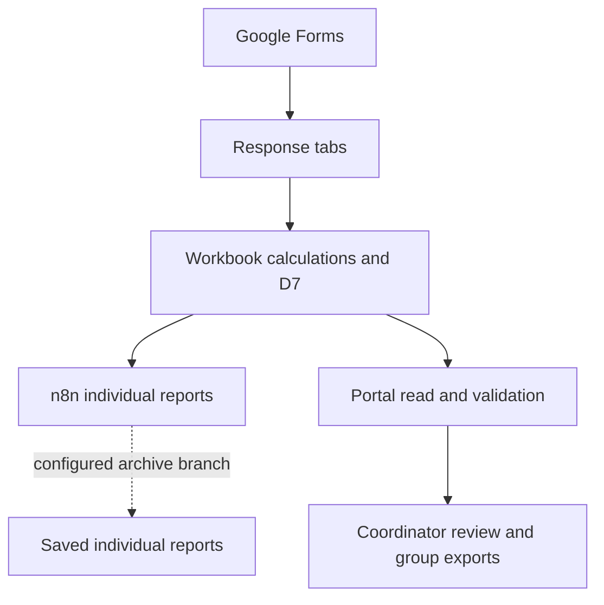

# OBE TraceX live integration runbook

## Actual data paths

[VERIFIED FROM REPOSITORY] Form responses enter their linked Google response tabs. Workbook formulas calculate criteria, averaged marks and D7 totals. The calculated workbook supports two outputs: n8n individual reporting and portal master imports. The portal need not wait for an email node to calculate a mark. Do not rebuild the calculation engine merely to create a linear Forms → n8n → portal diagram.

The dotted archive branch is pending for canonical live workflows. The separate read-only n8n bridge is an alternative way to read workbook values using existing credentials; it is not one of the seven grading senders.

## Stage mapping

[VERIFIED FROM REPOSITORY]

| Stage | Assessment | Max | Raw response tab | Additional criterion source |
|---|---|---:|---|---|
| D1 | Proposal defense | 12 | D1_Proposal | D1_Averaged_QEC |
| D2 | Semester 1 progress | 20 | D2_S1_Progress | Supervisor response detail |
| D3 | Semester 1 evaluation | 48 | D3_S1_Eval | D3_Averaged_QEC |
| D4 | Semester 2 progress | 48 | D4_S2_Progress | Supervisor response detail |
| D5 | Final report | 32 | D5_Final_Report | D5_Averaged_QEC |
| D6 | Final evaluation | 40 | D6_Final_Eval | D6_Averaged_QEC |
| D7 | Consolidation | 200 | Not a seventh evaluator Form | Calculated consolidated tab |

`master_sync.py` defines the consolidated tab as ` D7_CONSOLIDATED_GRADING`, including a leading space. XLSX lookup accepts a stripped version too, but Google range validation checks the expected name and order exactly. Confirm the real workbook names before changing them. `READ_TABS` has 11 tabs: one master, four averages and six responses. Values are read from A1:Z10000. A populated boundary row is rejected rather than silently truncating a larger source.

## Step 1 Establish ownership and mapping

Use `stage_mapping_template.csv` to record, privately, each canonical Form editor ID, respondent URL, workbook ID, tab and matching workflow. Six records already exist locally but require owner verification. An editor link and a respondent link are different identifiers. Confirm the actual Form title and linked response destination while signed in as the owner. The Forms home page or copied Form names are insufficient evidence.

Keep live and TEST identifiers separate. Use department-owned Google identities and a designated n8n/IT owner. Obtain the current faculty roster and approved historical marks. The public pack supplies blank mapping fields; actual saved local Form links are backed up privately in `stage_forms_private.json`.

## Step 2 Prepare isolated copies

Preserve the original seven exports, working spreadsheet and private n8n configuration. Use TEST Forms connected explicitly to a TEST workbook with the same verified formulas. Export/copy workflows into an isolated test instance or new inactive IDs. An import can overwrite an existing workflow with the same ID, so inspect IDs and targets before importing.

Set test recipients deliberately before enabling any email sender. This handover does not authorize sending test reports to faculty or enabling live grading workflows. Use the existing manual read utility where possible; do not execute the full grading workflow to test a GET-only reader.

## Step 3 Choose the portal read method

**Existing laptop bridge.** Private `connection.cmd` binds `OBE_N8N_BRIDGE`, `OBE_MASTER_SNAPSHOT` and workbook configuration. `tools/refresh_n8n_master.py` invokes workflow `OBEReadOnlyLocal01`, extracts its fresh batchGet result, checks the workbook ID and writes a snapshot atomically. If the live call fails, the adapter rejects it; it must not treat an old file as a fresh successful read. Google credentials stay in n8n. Their account scope can be broader than the bridge's GET operation.

**Direct departmental reader.** Configure `GOOGLE_APPLICATION_CREDENTIALS` with an approved credential file outside Git and `GOOGLE_WORKBOOK_ID` with the verified TEST workbook ID. Give that reader viewer access to the intended workbook. The code requests `spreadsheets.readonly`. Confirm successful manual read before starting a worker. Switching to this method on the existing laptop also requires removing/clearing `OBE_N8N_BRIDGE`, otherwise the adapter chooses the bridge.

Both methods feed `import_master`, which matches official seats, validates criteria and preserves frozen marks. They do not modify source formulas or activate n8n workflows.

## Step 4 Connect respondent access

Create approved evaluator assignments in the portal and save the correct stage Form link. Configure the owner-authorized token file through `OBE_GOOGLE_ACCESS_TOKEN_FILE`. This is separate from the spreadsheet reader credential; possession of a Sheets reader is not proof of permission to change Form respondents.

The code checks Form publishing support, matches the responder URI, rejects public/domain/group respondent access, changes individual respondent permissions and then compares the actual Google allowlist with the desired set. Current Google documentation describes a responder permission using `view=published` and `role=reader` and requires publishing support. Verify actual Forms on the department account rather than assuming every legacy Form supports this.

Portal assignment windows validate incoming raw evaluation events. They do not by themselves schedule Google respondent grants or close a Google Form. Current permission synchronization uses active assignments and is a manual action; department operating procedures must handle opening/closing and test forwarded-link rejection. Grant and revoke are not complete until Google synchronization and an actual allowed/denied account check succeed.

## Step 5 Connect individual report archiving

Use a copy of each canonical workflow. Add a separate branch after its HTML-generation node without replacing calculation/email nodes. Adapt `integrations/n8n/archive_report.js` to the actual input fields, stage, seat and academic session. It is a signing fragment, not a complete importable seven-workflow solution.

POST the exact `rawBody` string to `/integrations/n8n/report/` with header `X-OBE-Signature`, a lowercase HMAC-SHA256 hex signature. Both sides use `OBE_REPORT_WEBHOOK_SECRET` with at least 32 characters. The receiver falls back to `N8N_WEBHOOK_SECRET`, but separate secrets are preferable for the two endpoints. Do not log secret values or print student report payloads during testing.

The envelope contains event_id, issued_at and report fields: session, seat, attempt, stage, filename, extension and content_base64. Supported extensions are html, pdf and docx. Maximum decoded document size is 5 MiB and the receiver rejects raw bodies over 8 MiB. The timestamp must be within five minutes. Preserve a stable event identity on retries: equal bytes return unchanged; reusing an identity for different bytes is rejected. A successful response is saved or unchanged, not an academic approval.

Confirm an archived report's decoded bytes/hash, student/session/stage and private download. This does not require sending an email. Only after acceptance should the department authorize activation of the canonical senders. The existing code fragment uses Node crypto and environment access, which the target n8n security policy must support; do not loosen the entire instance for convenience.

## Step 6 Run the real-group acceptance

Use `acceptance_results_template.csv` and `docs/REAL_GROUP_END_TO_END.md`.

1. Import the official group roster into a dedicated TEST session.
2. Submit actual approved historical marks through the six corresponding TEST Forms, one stage at a time.
3. Capture evidence that the expected row, workbook criteria and D7 values update correctly.
4. Execute only the intended TEST reporting workflow and confirm its output/recipient configuration.
5. Read the workbook into the TEST portal session; compare every member and criterion with the approved reference.
6. Resolve discrepancies through faculty decisions; never change a formula merely to force a passing comparison.
7. Approve the session policy, freeze valid stages, approve the final result and verify each exact report template as Coordinator.
8. Download D1–D7 outputs and inspect marks, identities, references, signature areas and page boundaries.
9. Make an approved TEST correction; confirm the old snapshot remains protected, then reopen/reimport/reapprove and retain history.
10. Repeat for all three intended historical groups before claiming full historical replay. Record failures and missing evidence honestly.

## External documentation checked 24 November 2026

- n8n Google Sheets Trigger events: https://docs.n8n.io/integrations/builtin/trigger-nodes/n8n-nodes-base.googlesheetstrigger/
- Google Form publishing and respondents: https://developers.google.com/workspace/forms/api/guides/publish-form
- n8n backup/restore documentation source: https://github.com/n8n-io/n8n-docs/blob/main/docs/deploy/host-n8n/keep-n8n-running/backup-and-restore.md

These references describe service behavior, not proof that this project's credentials or workflows have passed.
